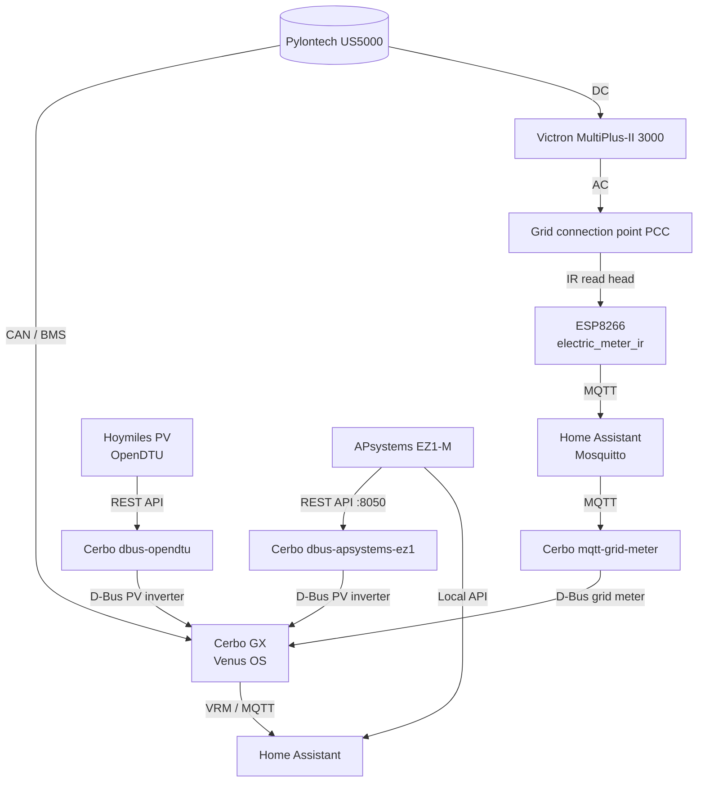

# Home Automation

Configurations for my smart home setup: grid meter, balcony PV (OpenDTU/Hoymiles),
and a Victron ESS (MultiPlus-II + Pylontech) on Cerbo GX / Venus OS.

## Overview

The repository is split into three areas:

- [esphome/](esphome/) – ESPHome firmware YAMLs for the ESP devices
- [homeassistant/](homeassistant/) – Home Assistant configuration (packages, dashboard,
  and the mirrored top-level config files)
- [venus-os/](venus-os/) – Services for the Cerbo GX / Venus OS

### Current power system



Charge/discharge and ESS behaviour are handled by the MultiPlus-II under Venus OS
(with the Pylontech BMS). Home Assistant no longer drives a lab PSU or a Soyosource
limiter for battery control.

The IR meter publishes its values via MQTT so that a Venus OS service on the Cerbo GX
can turn them into a Victron grid meter on D-Bus. Venus OS cannot read ESPHome devices
directly; the MQTT-to-D-Bus service on the Cerbo remains necessary. The service lives in
[venus-os/mqtt-grid-meter/](venus-os/mqtt-grid-meter/) and uses the Home Assistant MQTT
broker; Node-RED is not needed.

OpenDTU/Hoymiles data is integrated on the Cerbo as a PV inverter, not as another grid
meter. For that, `henne49/dbus-opendtu` runs directly on Venus OS and queries OpenDTU
through the REST API. An installation note and example configuration are available under
[venus-os/](venus-os/).

### Retired hardware (kept for reference)

The following paths remain in the repo but are **not in use** anymore (replaced by the
MultiPlus-II + Pylontech ESS):

| Path | Former role |
| --- | --- |
| [esphome/riden-psu.yaml](esphome/riden-psu.yaml) | RD6030W via Modbus on the Riden WiFi dongle |
| [esphome/soyosource-victron-esp32.yaml](esphome/soyosource-victron-esp32.yaml) | Soyosource GTN limiter + Victron MPPT/SmartShunt telemetry |
| [homeassistant/packages/rd6030_battery_surplus_charge.yaml](homeassistant/packages/rd6030_battery_surplus_charge.yaml) | HA surplus charging via RD6030W |
| [homeassistant/packages/soyosource_feed_in_control.yaml](homeassistant/packages/soyosource_feed_in_control.yaml) | HA feed-in control for the Soyosource |

## ESPHome

| File | Hardware | Purpose | Status |
| --- | --- | --- | --- |
| [esphome/electric_meter_ir.yaml](esphome/electric_meter_ir.yaml) | ESP8266 (D1 mini) + Hichi IR read head | Read the SML meter via UART, expose OBIS values as HA sensors / MQTT | Active |
| [esphome/riden-psu.yaml](esphome/riden-psu.yaml) | ESP8266 (Riden WiFi dongle / ESP-12F) + Modbus RTU | RD60xx power supply control | Retired |
| [esphome/soyosource-victron-esp32.yaml](esphome/soyosource-victron-esp32.yaml) | ESP32 + MAX485 + VE.Direct | Soyosource limiter + MPPT/Shunt telemetry | Retired (uses pinned external components) |

Shared blocks (WiFi, API, OTA, web server) live in
[esphome/common/base.yaml](esphome/common/base.yaml) and are pulled into each device
config via `packages: base: !include common/base.yaml`.

External components used by active configs: none beyond stock ESPHome (SML meter).
The retired Soyosource config additionally uses external components pinned to
full Git commit hashes, with `refresh: never`:

- [syssi/esphome-soyosource-gtn-virtual-meter](https://github.com/syssi/esphome-soyosource-gtn-virtual-meter)
- [KinDR007/VictronMPPT-ESPHOME](https://github.com/KinDR007/VictronMPPT-ESPHOME)

These are **not vendored**. A clean checkout downloads the pinned revisions into
the ignored `esphome/.esphome/` cache; `refresh: never` prevents subsequent updates,
not the initial download. The hashes identify upstream snapshots selected on
2026-10-11, not revisions recovered from the formerly deployed firmware. Review
and test retired hardware before reactivation. Firmware tooling is pinned to
ESPHome 2026.9.1 in `pyproject.toml` / `uv.lock`.

`riden-psu.yaml` was *inspired by* [morgendagen/riden-dongle](https://github.com/morgendagen/riden-dongle)
but uses only stock ESPHome `modbus_controller` and does not depend on that external component.

### Secrets

Create `esphome/secrets.yaml` from
[esphome/secrets.yaml.example](esphome/secrets.yaml.example) and fill it in
(WiFi, OTA, a separate fallback AP password, API key, web credentials, and MQTT
for the IR meter). Existing secret files need `fallback_ap_password`,
`web_server_username`, and `web_server_password` before the next firmware build.

### Flashing

From the repository root:

```sh
uv sync --locked --group firmware --python 3.12
uv run --locked --group firmware esphome run esphome/electric_meter_ir.yaml
```

Use the actual secret file and review the config before flashing; the validation
fixture below is public dummy data and must never be flashed.

### Network security

- The shared HTTP interface requires Digest authentication, and web OTA is disabled
  on the normal interface. Digest does **not** encrypt readings or commands; restrict
  access to a trusted IoT LAN. Use `curl --digest` for authenticated REST requests.
- Native API encryption and password-protected native OTA remain enabled. The
  fallback AP uses a separate password; captive-portal recovery still permits web
  OTA when that AP is active. Do not expose device interfaces to the internet.
- Stock ESPHome MQTT TLS is supported on ESP32, **not this ESP8266 meter**. Its
  MQTT credentials/readings still traverse plaintext port 1883. Isolate that hop
  using a dedicated IoT network, broker-bound LAN listener, and firewall rules;
  disable anonymous access and use a dedicated topic-restricted meter account.
  Device MQTT discovery is disabled, so use its known address for OTA/log access.
- The Cerbo bridge supports verified TLS independently; configure the broker's
  TLS listener and CA before enabling it. See
  [the transport and ACL notes](venus-os/mqtt-grid-meter/README.md#mqtt-transport-and-broker-security).
  Encrypting this hop does not secure the preceding plaintext meter hop.

## Development and CI

The deployed bridge still supports Python 3.8 and requires no pip runtime packages
beyond the Venus OS-provided D-Bus modules. Development and firmware tools use
Python 3.12–3.14 in separate dependency groups, with exact direct versions and
transitive hashes in `uv.lock`:

```sh
uv sync --locked --python 3.12
uv run --locked ruff check venus-os/mqtt-grid-meter homeassistant/tests tools tests
uv run --locked ruff format --check venus-os/mqtt-grid-meter homeassistant/tests tools tests
uv run --locked pyrefly check
uv run --locked pytest
uv run --locked yamllint homeassistant esphome .github
uv run --locked --group firmware python tools/validate_esphome.py
```

The firmware check copies only tracked config/example files to a temporary directory,
uses dummy credentials, and runs `esphome config` without reading real secrets or
flashing hardware. Pass tracked device filenames to check retired configurations too.
Build/compile checks still require platform toolchains and are separate from schema
validation. First-time tool installation and external-component validation download
public packages/source from PyPI/GitHub.

[CI](.github/workflows/checks.yaml) runs these checks plus the bridge tests on Python
3.8 without development packages. GitHub Actions are pinned to commit hashes.
Intentional tool upgrades should update `pyproject.toml` and regenerate `uv.lock`.

## Home Assistant

| File | Purpose | Status |
| --- | --- | --- |
| [homeassistant/packages/energy_meter_common.yaml](homeassistant/packages/energy_meter_common.yaml) | Shared sensors derived from the grid meter (`sensor.grid_power_average`) | Active |
| [homeassistant/packages/ir_heizung_kinderzimmer2_control.yaml](homeassistant/packages/ir_heizung_kinderzimmer2_control.yaml) | Opt-in IR heater control after 60 s of export covering configured heater watts + 300 W, with SOC/power interlocks and explicit HVAC off | Active |
| [homeassistant/packages/waste_collection.yaml](homeassistant/packages/waste_collection.yaml) | Waste collection schedule (HACS integration, ICS source) | Active |
| [homeassistant/packages/rd6030_battery_surplus_charge.yaml](homeassistant/packages/rd6030_battery_surplus_charge.yaml) | Surplus charging via RD6030W | Retired |
| [homeassistant/packages/soyosource_feed_in_control.yaml](homeassistant/packages/soyosource_feed_in_control.yaml) | Soyosource feed-in control | Retired |

The [homeassistant/](homeassistant/) directory mirrors a complete Home Assistant config
directory; see [homeassistant/README.md](homeassistant/README.md) for installation and
the YAML dashboard. Device credentials live in `esphome/secrets.yaml`; one HA secret is
still required (`waste_ics_url`) for
[homeassistant/packages/waste_collection.yaml](homeassistant/packages/waste_collection.yaml).

Battery SOC/power and MultiPlus metrics come from the Cerbo GX / VRM integration (e.g.
`sensor.gx_device_dc_batterieladung`, `sensor.gx_device_dc_batterieleistung`), not from
the retired ESP32 VE.Direct bridge.

## Safety notes

- MultiPlus-II AC wiring, battery cabling, and Pylontech CAN/BMS setup belong in
  qualified hands and must follow Victron/Pylontech installation manuals.
- ESS charge limits and battery protection are handled by Venus OS + the Pylontech BMS;
  Home Assistant automations must not bypass those limits.
- Start with conservative ESS setpoints and observe live operation before raising limits.

## License

[MIT](LICENSE)
